  <picture>
    <source media="(prefers-color-scheme: dark)" srcset="./shift-dark.svg">
    <source media="(prefers-color-scheme: light)" srcset="./shift-light.svg">
    
  </picture>

This is what my AI does all day.

### I'm Shoikot.

**I build [hiublue](https://hiublue.com): a whole company in one app.**

Cancel the CRM, the scheduler, the invoicing app, the social tool and the agency. Keep one platform. And you legally own your data.

#### Your AI employee gets its own computer and phone number. You just text it. It runs:

<table>
<tr>
<td valign="top" width="50%"><b>📊 Your whole business, at a glance.</b> One live summary. Every morning, on your phone.</td>
<td valign="top" width="50%"><b>🎯 Leads to customers.</b> Finds leads, runs the campaign, closes the deal.</td>
</tr>
<tr>
<td valign="top" width="50%"><b>📱 Its own phone number.</b> Calls and texts. Email, iMessage, WhatsApp and DMs too.</td>
<td valign="top" width="50%"><b>📣 Your social and ads.</b> Posts for you. Runs your ads.</td>
</tr>
<tr>
<td valign="top" width="50%"><b>📅 Your calendar.</b> Books, moves and fills your schedule.</td>
<td valign="top" width="50%"><b>💸 Your money.</b> Pays bills. Sends invoices. Gets you paid. Keeps the books.</td>
</tr>
<tr>
<td valign="top" width="50%"><b>✍️ Your paperwork.</b> Drafts the contract. Gets it signed.</td>
<td valign="top" width="50%"><b>🛠️ Your systems.</b> Builds automations, websites and tools. Plugs into any software.</td>
</tr>
</table>

**Your whole team works there too.** People and AI, side by side. Anything big waits for your OK.

**We run hiublue on hiublue.**

[hiublue.com](https://hiublue.com) · [instagram.com/mrshoikot_](https://instagram.com/mrshoikot_)

---

Builder, not influencer.
